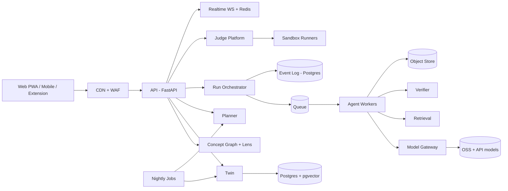
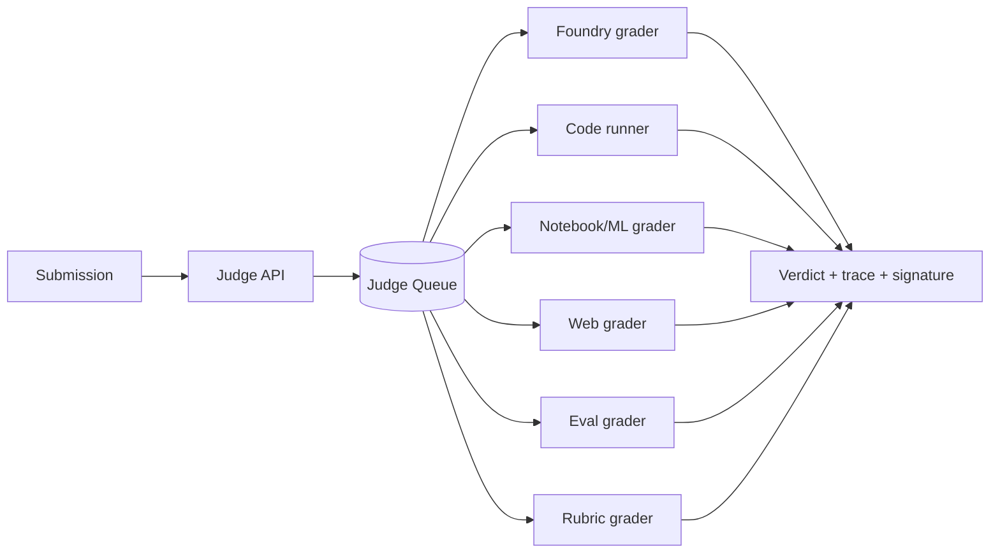

# Architecture

## 1. Shape and principles
- Modular monolith first (API + workers + shared packages). Split out only the sandbox fleet and the realtime gateway.
- Event-sourced **runs** (agent executions). Everything else is plain CRUD.
- Client-side compute wherever possible; **never trust client verdicts** for ranked results or credentials.
- Every score carries a trust label: VERIFIED / SOURCED / MODEL / JUDGED.



## 2. Stack and rationale
- **Client:** Next.js PWA (shareable URLs, OG images, SEO). KaTeX, Monaco, SVG/D3 viz templates. Pyodide in a Web Worker for Python labs (NumPy/pandas/scikit-learn; verify the current package list). Mobile shell later (Expo/React Native) on the same API. Optimize for low-end Android.
- **API:** FastAPI (Python agent/ML ecosystem); SSE for streaming.
- **Agent graphs:** LangGraph inside a run. Durable queue: Postgres-backed at MVP. Move to Temporal when workflows need long timers or human-in-the-loop.
- **Data:** Postgres 16 (+ pgvector, partitioned event tables), Redis (cache, rate limits, ZSET leaderboards, pub/sub), S3/R2 object store. ClickHouse later; hosted product analytics at MVP.
- **Models:** gateway with routing, budgets, fallbacks. Tiers: T0 tiny (classify, route, extract), T1 mid open-source (drafts, deltas), T2 frontier (verification, offline generator authoring). Pick concrete models by evals, and check each model's license terms.
- **Sandboxes:** Tier A in-browser (Pyodide; Sandpack-style bundlers for front-end). Tier B server runners (gVisor or Firecracker-class microVMs).
- **WebContainers caution:** the WebContainer API is free for non-commercial use but needs a commercial license for production use in for-profit apps. Budget for it or use alternatives.
- **PyTorch caution:** as far as I know it isn't available in Pyodide. Use from-scratch/NumPy autograd labs for teaching (also better pedagogy), and run torch labs in Tier B CPU containers or an "open in Colab" export.
- **Observability:** OpenTelemetry → Grafana, Langfuse for LLM traces/evals, Sentry.
- **Infra:** managed PaaS + Cloudflare at MVP; India region for latency and residency; Terraform once stable.
- **Auth:** Google + email OTP (+ phone OTP optional); age gate.

## 3. Services (modules)
- **Concept Graph/Lens:** immutable graph versions, lens definitions, alias table.
- **Twin:** mastery, stability, error clusters, calibration.
- **Planner:** daily plan optimizer.
- **Run Orchestrator + Agent Workers:** lesson/delta generation.
- **Model Gateway:** routing, caching, cost metering.
- **Retrieval + Verifier:** receipts and claim checks.
- **Judge Platform:** unified grading (see §9).
- **Foundry:** generator registry, pools, answer-key service.
- **Renderers:** web, audio, slides, chat-app text, reel.
- **Realtime/Social:** Daily Drop, Boss, leagues, duels, rooms.
- **Share/SEO:** OG images, static lesson pages.
- **Admin/Review:** generator review, lesson review, flags.

## 4. Concept Graph and lens engine
```sql
create table concept_node (
  id text, graph_version int, title text, kind text,
  prereqs text[], difficulty_prior real, volatile bool, review_by date,
  primary key (id, graph_version)
);
create table node_alias (old_id text primary key, new_id text);
create table lens (
  id text primary key, goal_type text, config jsonb  -- milestones, mock config
);
create table lens_node (
  lens_id text, node_id text, weight real, ord int,
  primary key (lens_id, node_id)
);
```
- Load the active graph into memory per process (≈2k nodes; recursive CTE for ad-hoc queries).
- Twin rows reference `node_id`; merges and renames go through `node_alias`.
- Readiness for any lens is computed on demand: `Σ w·m_eff / Σ w`.

## 5. Agent runtime
### Run lifecycle
CREATED → PLANNED → RUNNING → VERIFYING → READY (or REGEN → VERIFYING) → FAILED / CANCELLED.

### Event log
```sql
create table run_events (
  run_id uuid, seq int, ts timestamptz default now(),
  type text, agent text, payload jsonb, parent_seq int, hash text,
  primary key (run_id, seq)
) partition by hash (run_id);
```
- Append-only. **Replay = replay recorded model outputs and tool results.** LLMs are non-deterministic, so "re-run" means a new run branched from seq N with a changed prompt or model, shown as a diff.

### Blackboard
Typed artifacts (Pydantic/JSON Schema, versioned): Plan, Evidence[], Draft, VisualSpec, LabSpec, ProblemSet, VerifierReport, LessonIR. Agents declare `consumes`/`produces`; the scheduler runs the DAG on readiness.

### Budgets, degradation, speculation
- Per-run limits: tokens, USD, wall time; sub-budgets per agent; cancellation tokens.
- Degrade ladder: drop the visualizer → serve cached core without delta → serve the previous version with an "updating" badge.
- Speculate only on cheap steps (start the lab builder once the concept list exists); cancel on a verifier veto of those concepts.

### Verifier veto
Per block: `{block_id, verdict: pass|fail|unverifiable, receipt}`. Regenerate only failed blocks (max 2), then strip or label as MODEL.

### Agent roster (mostly code at MVP)
- Orchestrator: code.
- Planner: hybrid (rules + T0/T1 + Twin query).
- Researcher: retrieval + T1 rerank.
- Explainer: T1 (T2 for hard topics).
- Visualizer: LLM emits a JSON spec rendered by prebuilt components (no free-form generated code at MVP).
- Builder/Coder: T1 + sandbox validation.
- Examiner: code (Foundry) + T0 for wording.
- Verifier: T2 + executable checks.
- Twin updater: code (BKT) + T0 summaries.
- Teaching **skills** (procedural memory): `SKILL.md` folders, see §22.

## 6. Lesson IR, renderers, cache, i18n
```json
{
  "lesson_id": "dbms.normalization.bcnf@v3",
  "core_version": 3, "lang": "en", "depth": "standard",
  "blocks": [
    {"id": "b1", "type": "claim", "text": "…", "badge": "SOURCED",
     "receipt": {"kind": "source_span", "source_id": "…", "span": [120, 310], "license": "CC-BY-SA"}},
    {"id": "b2", "type": "intuition", "text": "…", "badge": "MODEL"},
    {"id": "b3", "type": "example", "ref": "foundry:fd_closure", "badge": "VERIFIED"},
    {"id": "b4", "type": "viz", "template": "fd_graph", "spec": {}},
    {"id": "b5", "type": "lab", "runtime": "pyodide", "starter": "…"},
    {"id": "b6", "type": "check", "foundry": "bcnf_decompose"}
  ]
}
```
- **Core cache key:** `core:{track}:{node}:{lang}:{depth}:{style}:{core_version}`.
- **Delta:** JSON Patch over the core from T0/T1; not cached (or cached per weakness cluster).
- **Pre-generation:** batch jobs fill ~7k cores before launch; human review queue ordered by traffic.
- **i18n:** per-language glossary protects technical terms; separate generation prompts per language; bilingual review sampling; TTS quality evaluated per language.
- **Freshness:** nodes with `volatile = true` run scheduled source checks; failures enqueue regeneration and review.

## 7. Twin service
```sql
create table twin_state (
  user_id uuid, node_id text, p_known real, stability_days real,
  last_seen timestamptz, attempts int,
  primary key (user_id, node_id)
);
create table attempt (
  id uuid primary key,            -- client-generated UUIDv7, idempotent
  user_id uuid, node_id text, instance_id uuid, judge_job_id uuid,
  correct bool, confidence smallint, hint_level smallint,
  latency_ms int, error_tag text,
  policy_id text, propensity real, ts timestamptz default now()
);
create table calibration_bin (
  user_id uuid, subject text, conf_bin smallint, n int, n_correct int,
  primary key (user_id, subject, conf_bin)
);
```
- A stream consumer applies BKT and stability updates per attempt; it is idempotent on `attempt.id`.
- **Recompute path:** the Twin can always be rebuilt from `attempt`.
- **Nightly job (off-peak):** recompute stability, cluster error tags (tag counts at MVP, embeddings later), update calibration bins, pre-plan "Today", prune stale detail.
- Export/delete: one endpoint dumps/deletes the user's rows across tables.

## 8. Planner service
- Input: user, lens, Twin snapshot, time budget, goal date.
- Output: ordered items `{type: lesson|practice|review|quest|mock, node_id, est_min, reason, policy_id, propensity}`.
- Algorithm per SystemsDesign §4: candidates → gain/cost greedy → interleave → exploration slice.
- Deterministic given inputs + seed, so it can be replayed and A/B tested.

## 9. Judge Platform (unified grading)

- Contract: `JudgeJob{kind, submission_ref, spec_ref, limits, seed}` → `Verdict{score, checks[], artifacts[], trace, trust_label, signature}`.
- **Foundry grader:** in-process; answer keys stay server-side.
- **Code runner:** language images; hidden + property tests; counterexample shrinking (ddmin or Hypothesis-style).
- **Notebook/ML grader:** numeric tolerance on hidden seeds; finite-difference gradient checks; metric thresholds.
- **Web grader:** microVM runs the learner app; contract tests, Playwright, security scan, k6 thresholds; no network by default.
- **Eval grader:** replays recorded model responses (cassettes) so labs are deterministic and free; optional live calls under quota.
- **Rubric grader:** deterministic checks + calibrated LLM judge, always labeled JUDGED.
- **Client-first:** run in the browser for instant feedback. Ranked, Boss, duels and Skill Passport use the server verdict only.
- **Signing:** verdicts are signed so Skill Passport evidence is tamper-evident.

## 10. Problem Foundry
```python
class Generator(Protocol):
    id: str
    node_ids: list[str]
    def sample(self, rng, difficulty) -> Params: ...
    def solve_a(self, p: Params) -> Answer: ...    # independent implementation A
    def solve_b(self, p: Params) -> Answer: ...    # independent implementation B
    def trace(self, p: Params) -> list[Step]: ...  # oracle trace
    def mistakes(self) -> list[MistakeModel]: ...  # wrong answer + tag
```
- **Publish pipeline:** LLM authors → static checks → A == B on 10k+ seeds → property tests → human-verified golden cases → one-time human review → publish vN.
- **Runtime:** pre-generate instance pools per (generator, difficulty bucket); serve in milliseconds; answer keys server-side; calibrate difficulty with IRT after enough attempts.
- **Per-track catalogs:** GATE (scheduling, paging, cache, DFA, parsing tables, subnetting, normal forms, B+ trees, pipelines…), ML (reference-matching tasks), Full Stack (contract and query tasks), AI (retrieval and injection scenarios).

## 11. Reasoning-Diff
1. Input: typed steps or a photo.
2. A vision model transcribes to a step DSL.
3. The learner confirms the reading.
4. Align with the oracle trace (DP alignment over normalized states).
5. Report the first divergence and the violated invariant.
6. The LLM only phrases the explanation; facts come from the diff.

For code: differential test against a reference, then shrink the failing input to a minimal counterexample.

## 12. Retrieval and receipts
- Ingest only licensed or open corpora; store license, URL and span offsets per chunk.
- Hybrid search: BM25 + pgvector + rerank.
- Claim extraction → entailment check against the cited span → receipt.
- Policy: unsupported factual claims are stripped or labeled MODEL.
- Retrieved text is untrusted input (see §20).

## 13. Sandbox tiers and Foundry infrastructure
- **Tier A (default):** in-browser runtimes; zero server cost.
- **Tier B:** server microVMs with copy-on-write snapshots for "rewind/fork"; free quota (e.g. 30 min/day), idle kill at 5 min; egress denied by default; seccomp; CPU-anomaly kill.
- **Fault Foundry:** prebuilt multi-service stack + fault injectors (latency, partition via toxiproxy/netem, leak, race); logs/metrics/traces exposed to the learner; grading by rubric + automated symptom check under load.
- **ML Debug Foundry:** parametrized bug injectors over reference training scripts; graded on locating and fixing the bug.
- **Eval Foundry:** record/replay proxy for model calls; hidden question sets; attack payload suites.

## 14. Offline-first and sync
- Client store (IndexedDB or SQLite-WASM) holds downloaded lesson cores for the planned week and practice pools.
- Attempts are append-only with client-generated UUIDv7 ids, so sync is idempotent; the server recomputes the Twin and the client shows an optimistic estimate.
- Offline practice is **unranked**: answer material on the device means no leaderboards, Boss, duels or credentials from offline attempts.
- Lite mode: text-only lessons, no heavy WASM, compressed assets.

## 15. Realtime and social
- Separate WebSocket service + Redis pub/sub and ZSETs.
- **Daily Drop:** one seed per track per day; server checks answer hash; result grid generated server-side.
- **Boss Fight:** weekly seed, pre-generated pool, server timer, ZSET leaderboard.
- **Duels:** shared seed, server-authoritative timing, Glicko-2.
- **Leagues:** weekly cohorts (~30) by track and level.
- **Study rooms:** presence counts only.
- Anti-cheat: server keys, time bounds, latency/answer-pattern checks.

## 16. Notifications and bots
Web push first. Telegram bot for quick revise (free to run). WhatsApp later: per-message costs and opt-in rules apply. Quiet hours and caps enforced centrally.

## 17. Public SEO pages
- Static generation from reviewed cores (`/learn/{track}/{node}`) with an interactive client-side lab.
- Pages stay `noindex` until a node passes review and verification.
- Sitemaps per track; canonical URLs; structured data for courses and FAQs.

## 18. Core data (beyond §4 and §7)
```sql
create table instance_pool (
  generator_id text, version int, bucket smallint, instance_id uuid,
  params jsonb, primary key (generator_id, version, instance_id)
);
create table judge_job (
  id uuid primary key, kind text, user_id uuid, spec_ref text,
  status text, verdict jsonb, signature text, created_at timestamptz
);
create table share_artifact (
  id uuid primary key, user_id uuid, kind text, payload jsonb, created_at timestamptz
);
```
Retention: event log hot 90 days then archived/aggregated; attempts kept (needed to rebuild the Twin); viva and handwriting uploads short retention.

## 19. API surface (v1)
- `POST /v1/runs` → run_id; `GET /v1/runs/{id}/stream` (SSE)
- `GET /v1/tracks`, `GET /v1/lenses/{id}`, `GET /v1/tree?lens=`, `GET /v1/readiness?lens=`
- `GET /v1/plan/today`; `GET /v1/lessons/{id}`
- `POST /v1/attempts` (carries confidence + hint level)
- `POST /v1/judge/jobs`, `GET /v1/judge/jobs/{id}`
- `POST /v1/reasoning-diff`
- `GET /v1/daily-drop`, `POST /v1/daily-drop/answer`
- `POST /v1/duels`, `WS /v1/rt`
- `GET /v1/passport/{id}` (public verification link)
- `GET|DELETE /v1/me/data`
- All mutations take an `Idempotency-Key`.

## 20. Security and privacy
- **Prompt injection:** retrieved text is untrusted; per-agent tool permissions; schema-validated outputs; only Retrieval has network egress.
- **Sandboxes:** isolation, quotas, abuse detection, no network by default, signed verdicts.
- **AuthZ:** row-level by `user_id`; separate admin plane.
- **Abuse:** rate limits per user/IP; per-user daily budget for metered generative features.
- **Supply chain:** pinned dependencies; only reviewed, first-party skills in production; treat third-party skills and registries as untrusted code.
- **Privacy:** encrypt at rest; consent logs; minors gated; companion extension processes locally where possible; no data sale.

## 21. Cost control
- **Free-unlimited (near-zero marginal cost):** Foundry, Code Arena, Match-the-Reference, browser labs.
- **Metered (LLM-heavy):** deep personalized regeneration, vision Reasoning-Diff, voice viva/interview, Tier B sandbox time.
- Levers: core cache; small-model deltas; client-side compute; nightly batch work; per-run budgets; pre-warm before exam season; self-hosted open models behind the gateway; cassette replay for labs.
- Formula: `cost/DAU-day = lessons × [(1 − hit) × core + delta + verify] + judge + TTS + sandbox`. Instrument per feature from day one.

## 22. Agent Skills as procedural memory
- Teaching behaviors live as `SKILL.md` folders (open Agent Skills format): `teach-with-analogy`, `author-foundry-generator`, `verify-lesson`, `diagnose-error-cluster`, `review-pull-request`.
- Progressive disclosure keeps context cheap: only short descriptions load by default.
- Skill CI/CD: offline scoring on logged data (needs the logged propensities) → 5% canary → auto-rollback on fast proxies.
- Dev side: use `anthropics/skills` (frontend-design, skill-creator, webapp-testing, mcp-builder) with your coding agent.

## 23. Observability and SLOs
- Traces: OpenTelemetry across API → worker → judge; Langfuse for prompt/model versions, cost and eval scores.
- Dashboards: cost per DAU-day by feature, cache hit rate, verifier veto rate, queue depth, judge latency, error-report rate.
- Alerts: queue depth, cost per run spike, judge failures, sandbox anomalies, leaderboard anomalies.
- SLOs: lesson first content ≤ 2 s (p95), problem serve ≤ 300 ms (p95), judge p95 targets from SystemsDesign §1.

## 24. Testing and evals
- **Golden lessons:** 50 hand-reviewed; rubric LLM-judge calibrated against human grades; CI gate on prompt/model/skill changes.
- **Verifier eval:** inject known false claims; track catch rate.
- **Foundry:** differential, property and mutation tests.
- **Judge:** known-good and known-bad submissions per spec; flake detection; determinism checks.
- **Load:** k6 on API and SSE; chaos-kill workers mid-run; sandbox abuse tests.
- **Efficacy:** A/B with pre/post diagnostics; 5% global holdout.

## 25. CI/CD and environments
- Trunk-based; PR checks: lint, types, unit, Foundry differential tests, golden-lesson evals, judge fixtures.
- Environments: dev, staging (with seeded graph + cassettes), prod. Feature flags per track and feature.
- Prompts, skills, graph versions and generators are versioned artifacts with rollback.

## 26. Deployment and scaling path
- **Stage 0 (0–5k MAU):** 1 API container, 2 workers, Postgres, Redis, R2, one small runner pool.
- **Stage 1 (5k–100k):** autoscale workers on queue depth; read replicas; separate WS service; self-hosted inference with burst GPU; dedicated judge fleet.
- **Stage 2 (100k+):** partitioned event log, ClickHouse, Temporal, multi-region edge cache, microVM fleet.
- **What breaks first:** LLM cost → queue latency at exam peaks → event-log write volume → judge fleet saturation during Boss Fights.

## 27. Repo layout
```
/apps/web  /apps/api  /apps/worker  /apps/realtime  /apps/judge
/packages/lesson-ir  /packages/foundry  /packages/graph
/packages/viz-templates  /packages/judge-specs
/skills    (SKILL.md teaching skills)
/content   (graph versions, lens defs, generator specs)
/evals     /infra
```

## 28. Build plan with exit criteria
- **W0 (weeks 0–1):** concierge test; graph v0 (DBMS + OS); 5 generators with differential tests; cost logging. Exit: retention and cost gates from SystemsDesign §12.
- **W1 (days 1–90):**
  - Weeks 1–2: monorepo, auth, graph + lens engine, Lesson IR + renderer, model gateway, event log.
  - Weeks 3–4: Explainer + Verifier + receipts + core cache; Twin v1 with propensity logging; skill-tree UI; Today planner; Reasoning-Diff (typed); Daily Drop; share cards; SEO pages; beta with 100–300 users.
  - Days 30–90: full GATE graph; mocks; Revive; Boss Fight; Hint Ladder.
- **W2 (days 60–120):** Judge Platform (code, notebook), Code Arena, Match-the-Reference, Full Stack + ML lenses, Build Quests v1, leagues, duels, Hinglish, offline mode, Telegram bot, handwriting Reasoning-Diff, Attempt Advisor.
- **W3 (days 120–200):** AI lens, cassette replay + Eval Foundry, Fault and ML Debug Foundries, Skill Passport, interview simulator, institute dashboard.

## 29. ADRs
1. Modular monolith before microservices.
2. Tracks are lenses over one Concept Graph.
3. Cache-first personalization (core + delta).
4. Client-side compute before server sandboxes; server re-verifies anything ranked or credentialed.
5. Unified Judge Platform with signed verdicts.
6. Template-based visuals before generated animation code.
7. Replay = recorded outputs, not re-execution.
8. Foundry trust = independent solvers + review, not LLM consensus.
9. Log propensities from day one.
10. Postgres as the event log until volume forces a change.
11. Trust badges (VERIFIED / SOURCED / MODEL / JUDGED) on every item.
12. No NFT credentials; signed verifiable links.
